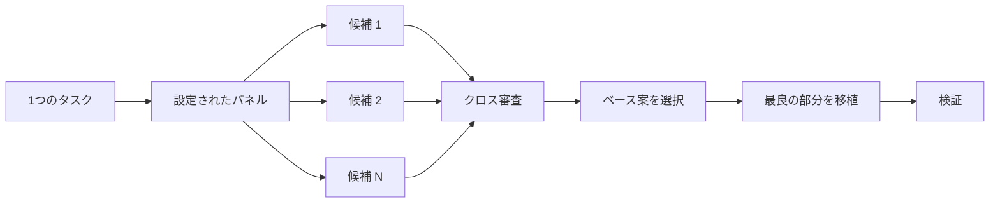

# コードを書く前に設計する

難しい設計を1回の試行だけで済ませようとすると、モデルが最初に思いついた形に固定されてしまいます。`/pstack:architect` は実装前に型と境界を確定させます。`/pstack:arena` は同じ指示書に対して複数の試行を並列実行し、それぞれの最も優れた部分を統合します。`/pstack:interrogate` は他のモデルに成果物を破壊させようと（問題点を見つけさせようと）します。設計の統合ではなく網羅性の確保が目的である場合は、`/pstack:swarm` が対象領域（スライス）や競争（レース）を並列展開し、その結果を集約します。

設計で最もよくある2つの失敗は、エージェントが最初に出した設計をそのまま採用してしまうことと、コードで一度も検証されていない計画書を磨き上げることです。このページではその両方を解決します。計画は「コードを通じて」立てるのです。プロトタイプが未解決の疑問に答えを出し、README やチュートリアルが目標を定め、文書としての計画書は最後に作成します。


## `/pstack:architect` で構造を確定させる

```text
/pstack:architect コードを書く前にインポートパイプラインを設計して。呼び出し側がどのように使うかを最も重視している。
```

[`/pstack:architect`](../../skills/architect/SKILL.md) はまず、その変更が影響するすべてのシステムをトレースします。次に、型、シグネチャ、モジュール境界を備えた2つの異なる構造案をスケッチし、「各状態に単一の所有者がいること」「各タスクの実行方法が1通りに定まっていること」「呼び出し側が知るべき知識が最小限であること」を満たす案を選択します。大規模な設計や意見が分かれる設計の場合は、単独でスケッチする代わりに `/pstack:arena` を実行します。コードを書く前に設計を確認したい場合は、プロンプトにその旨を明記してください。

いったんコードを書き始めたからといって、設計が神聖不可侵になるわけではありません。同じような場当たり的対応（ワークアラウンド）が何度も発生するようであれば、`/pstack:architect` はその場しのぎのパッチを当てるのではなく、設計そのものをやり直します。

## `/pstack:arena` で複数の試行を並列展開する

```text
/pstack:arena 私のプロンプトをそのまま一字一句変えずにアリーナにかけて。他の候補の提案とあなたの提案を比較したい。
```

[`/pstack:arena`](../../skills/arena/SKILL.md) はその裏側で動く汎用ツールです。N 個のサブエージェントが同じ設計またはコードの指示書に並列で取り組み、それぞれが専用の worktree またはディレクトリに書き出します。親チャットとは別のモデルファミリー（`opus`、`sonnet`、`haiku`、`fable`）の読み取り専用審査員（judge）が、評価基準（ルーブリック）に沿ってすべての候補を採点します。別ファミリーのモデルを実行できない場合は、コーディネーターが審査員ステップをスキップし、自らベース案を選択します。コーディネーターは各候補を端から端まで読み込み、ベースとなる案を1つ選んだうえで、選ばれなかった候補からも最良のアイデアを移植（graft）し、結果を検証します。



パネルの構成は [`/pstack:setup-pstack`](../../skills/setup-pstack/SKILL.md) の設定から読み込まれますが、タスクごとに調整することもできます。重要な意思決定のときは候補数を増やし、そうでないときは減らしてください：

```text
/pstack:arena これを5つの候補で試して。キャッシュキーの形式は後から変更するコストが高いから。
```

## `/pstack:swarm` で領域の網羅と競争（レース）をカバーする

```text
/pstack:swarm packages/ 配下のすべてのパッケージをそれぞれの check.sh でチェックして。パッケージごとに1ワーカーを割り当てて、1つのレポートにまとめて。
```

[`/pstack:swarm`](../../skills/swarm/SKILL.md) は、独立した対象領域（スライス）、カバレッジマトリクス、一連の検証レーン（gauntlet lanes）、探索パーティション、あるいは事前に宣言された競争（レース）の各アームに対して N 個のワーカーを並列展開します。各ワーカーには専用のスコープとチェック項目が与えられ、実行後に `PASS`、`ISSUES`、または `BLOCKED` を報告します。親エージェントはワーカーの完了を待ち、抜け漏れや脱落（ドロップアウト）があればそれも含めて1つのコンパクトなレポートにまとめて返します。

並列化によって網羅性を高めたいときや、独立したチェック同士を競わせたいときに使ってください。`/pstack:arena` がすべてのワーカーに同じ設計・コード指示書を与えてベース案の選択とアイデアの移植を行うのに対し、`/pstack:swarm` は領域を分担して網羅するか、事前に宣言された選択ルールに基づいて競争を実行します。ベース案の選択や移植といったプロセスは行いません。

## `/pstack:interrogate` で徹底的にアラを探す

```text
/pstack:interrogate ブランチ全体を懐疑的な視点で徹底的に検証して。実際のバグやリグレッションでない限り、細かい重箱の隅をつつくような指摘は不要。
```

[`/pstack:interrogate`](../../skills/interrogate/SKILL.md) は、変更内容とその意図を設定済みの各モデルの敵対的レビュアー（adversaries）に渡し、それぞれに実際のコードを実行させて破綻させようと試みさせます。モデルによって見つける不具合は異なります。指摘事項として生き残るのは、その再現コマンドを再実行した際に「本来の意図を破綻させる失敗」が実際に示されたものだけです。レポートには、検証済みのすべての指摘事項（発見したモデル名付き）と、各モデルが取り下げた指摘およびその理由が記載され、コードへの変更は一切適用されません。

取り下げられた指摘（Dropped）のリストにも目を通してください。あなた自身の判断でその判定を覆すこともできます。

## 議論する代わりにプロトタイプを作る

最初の設計案をそのまま採用してはいけません。いくつか案を出させ、目で見て確認できる証拠に基づいて選んでください：

```text
/pstack:poteto-mode 新しいドロップダウンメニューの案をいくつかプロトタイプで作って。比較できるようにスクリーンショットか動画を撮っておいて。
```

[Prototype プレイブック](../../skills/poteto-mode/playbooks/prototype.md) は、一時作業用ディレクトリに使い捨てのスケッチを構築し、1つのスイッチャーで各バリエーションを切り替えられるようにしたうえで、それぞれを実際に動かしてスクリーンショットや処理時間を記録します。これは UI だけでなく、振る舞いやアルゴリズムの検討にも有効です。プロトタイプは「コードを使った計画立案」です。あなたに質問する代わりに実際に動かしてみることでエージェント自身が未解決の疑問に答えを出せるようになり、あなた自身も思いつかなかったような選択肢が生まれる余地を作ります。

この同じ考え方は本格的な設計にも応用できます。`/pstack:architect` とプロトタイプを組み合わせ、レビューゲート（承認の関門）を設けてください：

```text
/pstack:poteto-mode 外部 Webhook 向けのレート制限が必要だ。まず /pstack:architect で設計し、未解決の疑問点はプロトタイプを作って答えを出して。次に進む前に私にレビューさせて。
```

抽象的な計画書に対して敵対的レビュアー（adversaries）を投入しないでください。`/pstack:interrogate` は実際の実行で証明できない指摘をすべて除外するため、裏付けとなるコードがない計画書では壊す対象がほとんどありません。まずはプロトタイプで疑問点に決着をつけ、実際に構築されたものをレビューしてください。

## 共有コードはまず README から書く

他のコードから利用されるパッケージや API を作る場合は、利用者が最初に読むドキュメントから書き始めてください：

```text
/pstack:poteto-mode まず新しい設定（config）パッケージの使い方を解説するチュートリアルを書いて。そのあと、なぜそれが現在のものより優れているのか /pstack:teach で教えて。
```

最初にチュートリアルを書くことで、呼び出し側（利用者）の視点が強制されます。仮想のユーザーに向けて API を説明し、そこから逆算して実装へと落とし込むのです。また、そのドキュメントはエージェントが自身の作業を照らし合わせてチェックするための具体的なターゲットにもなります。ドキュメント自体の品質が重要な場合は [`/pstack:technical-writing`](../../skills/technical-writing/SKILL.md) を指定してください。そうすることで、チュートリアルがリファレンスや解説と混ざり合うことなく、純粋なチュートリアルとして保たれます。

## 設計が固まった後に計画を立てる

pstack には意図的にプランニング専用スキルを用意していません。文書としての計画書が欲しい場合は、設計が固まった段階で依頼してください：

```text
/pstack:poteto-mode この設計を計画書に落とし込んで。それぞれ独自の検証ステップを備えた、小さく検証可能な PR 単位に分割して。
```

[Multi-phase plan プレイブック](../../skills/poteto-mode/playbooks/multi-phase-plan.md) は、残っている未解決の疑問をプロトタイプで解消したうえで、PR ごとに1つのセクションを記述し、各セクションの末尾に「その変更が機能することの証明方法」を記載します。単にテストスイートがパスするだけでは、その証明としては認められません。ここでの成果物は計画書そのものです。このプレイブックでは実装は行わず、あなたが「進めて（go）」と指示したときにのみ実行が開始されます。

マイグレーションの場合は、プロンプトで達成基準を明示してください：

```text
/pstack:poteto-mode UI ライブラリを新しいスタイリングシステムへ移行する計画を立てて。それぞれ視覚的リグレッションチェックを備えた、小さく検証可能な PR 単位にして。バグも含めて元の挙動と完全に一致する結果にすること。
```

「バグも含めて（bugs included）」と指定することで、移行の途中でこっそり不具合を直してしまい、新旧の出力比較ができなくなる事態を防げます。数日にわたるプロジェクトの場合は、他のエージェントが作業の進行状況を把握できるよう、しばらくの間その計画書をリポジトリにコミットしておいても構いません。作業が完了（マージ）したら削除してください。

## タスクに対してどれだけの設計作業をかけるべきか？

すべての変更にこれほどの設計作業が必要なのか疑問に思うかもしれません。答えは「いいえ」です。大半の変更にはまったく不要です。おおよその目安（段階）は次の通りです：

- すでに完成している小さな変更で、少し不安がある場合は `/pstack:interrogate` だけで十分です。
- 関数の境界をまたぐ変更や所有権の移動を伴う変更には `/pstack:architect` が適しています。設計が大規模だったり意見が分かれたりする場合は、自動的に `/pstack:arena` も併用されます。
- 命名規則、データフォーマット、アルゴリズムの選定など、独立した複数の試行が役立つ単体の意思決定には、直接 `/pstack:arena` を使います。
- カバレッジマトリクス、並列チェック群、あるいは条件を明示した競争（レース）には `/pstack:swarm` を使います。
- レイアウト、タイミング、実装アプローチなど、実際に動かしてみれば答えが出る未解決の疑問には、議論ではなくプロトタイプを使います。
- 後から覆すコストが高く、意見が分かれる設計には `/pstack:architect` を使い、リリース前に `/pstack:interrogate` で検証します。
- 複数の PR にまたがる作業には、設計が固まった後に計画書を作成します。

`/pstack:poteto-mode` はすでにこの基準を自動的に適用しています。境界をまたぐ作業であれば自律的に `/pstack:architect` を起動するため、あなたがこれらのスキルを直接呼び出すのは、主にデフォルトよりも厳密に（あるいは手短に）検証したいときだけです。

次へ：[変更の構築とクリーンアップ](./05-build-and-clean.md)
