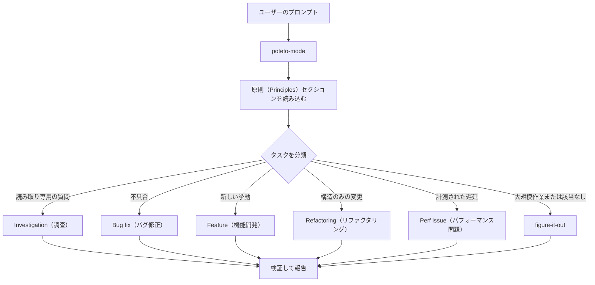

# `/poteto-mode` を通じて作業をルーティングする

`/poteto-mode` はすべての入り口（フロントドア）です。ゴールを伝えるだけで、22種類のプレイブックから最適なものをマッチングし、そのステップを Todo リストにコピーし、必要に応じて他のスキルを呼び出します。このページでは、良いプロンプトとはどのようなものか、そして実際にはどれほど短い指示で済むのかを解説します。


## プロンプトに起こる処理の流れ



この図は一般的なルーティングを示しています。このほかにも、メトリクスのヒルクライム改善、実行時の症状やキャプチャ済みトレースの診断、プロトタイプ作成、UI の視覚的パリティ（完全一致）、スキルの作成と評価、自律実行、PR の作成、PR やスタックをマージ可能状態まで導く babysit、検証済みスタックのシッピング、PR キューやスタックのオートパイロット実行、セッションの引き継ぎ、安全な一時停止、マルチフェーズ計画、worktree のクリーンアップといったプレイブックが用意されています。全一覧は[プレイブックディレクトリ](../../skills/poteto-mode/playbooks/)にあります。

## 儀礼的な前置きではなく、ゴールを伝える

仕様書を書く必要はありません。何が問題なのか、あるいは何を実現したいのかと、エージェントの探索時間を節約できる既知の情報を伝えるだけです：

```text
/poteto-mode リトライ後に通知が2通届いてしまう。まず再現させてから、修正して検証して。
```

これは Bug fix（バグ修正）のプロンプトです。「まず再現させて（repro first）」は単なる礼儀ではなく実際の制約として機能し、プレイブックはそれを厳格に守ります。Todo リストが Bug fix のステップで埋まっていく様子を見てみてください。

## プロンプトに含めるべき要素

実用的なプロンプトには最大5つの要素が含まれ、それぞれ1文に収まります：

- **ゴール（The goal）：** 何が問題なのか、または何を実現したいのかを伝えます。
- **完了条件（The done check）：** 合格（pass）か不合格（fail）かを明確に判定できる基準である必要があります。「もっと良くして」「1時間作業して」などはチェック基準になりません。
- **提示してほしい証拠（The proof you want to see）：** 実際のコマンド出力、動作フローの動画、保存された値、変更前後の数値などを求めます。
- **すでに分かっていること（What you already know）：** 症状、再現手順、ログの1行、リンクなどを共有すれば、エージェントが調査する手間を省けます。
- **実際の制約条件（The real constraints）：** 「まず再現させて」「まだコードを変更しないで」「挙動を一切変えないで」「次に進む前にレビューさせて」といった指示は、それぞれエージェントの行動を具体的に制御します。

5つの要素をすべて含んだプロンプトの例はこちらです：

```text
/poteto-mode 昨日のデプロイ以降、CSV エクスポートで最終行が欠落する。失敗しているジョブ ID は 4812。まず再現させてから修正して。6万行のテストデータ（フィクスチャ）ですべての行がエクスポートされたら完了とする。修正前後の行数を提示して。
```

逆に、省いたほうがよいものが2つあります：

- **具体的な手段（The how）：** 何を達成すべきかを伝え、あなた自身が思いつくよりも優れた解決策をエージェントが見つける余地を残してください。スキルのリストを並べることも同様です（詳細は後述の「落とし穴」を参照）。
- **最初から原因の推測を伝えること（Your theory of the cause, at first）：** 推測を先に伝えてしまうと、探索範囲がその方向に狭まってしまいます。自分の直感を共有する前に、まずはエージェント自身の言葉で問題を言い直させてください。

長いスレッドや曖昧なバグ報告など、ノイズの多いレポートの場合は、問題言い直し（restatement）を最初のステップにします：

```text
/poteto-mode このスレッドを読んで、根本にある問題を平易な日本語で自分の言葉に言い直して。まだコードは一切変更しないで。
```

読み違いがあれば、コードを1行も書く前のこの言い直しの段階で表面化します。ここで訂正すれば、間違った修正を1回行うコストではなく、メッセージ1通分のコストで済みます。プレイブックを使わずに言い直しだけを行いたい場合は、[`/in-your-own-words`](../../skills/in-your-own-words/SKILL.md) を実行してください。エージェントがあなたのゴールと解決しようとしている課題をどのように理解しているかを自分の言葉で言い直します。

プロンプトの狙いが的確かどうか迷ったときは、送信する前に [`/sharpen`](../../skills/sharpen/SKILL.md) を実行してください：

```text
/sharpen v2 設定フォーマット向けのマイグレーションガイドを書いて。
```

エージェントは、トッププロフェッショナルなら当然行うがあなたが指示していなかったこと、出発点となる最も生に近い一次資料、使用する手法とツール、そしてあなたやエージェント以外の第三者・外部手段によって結果の正しさを証明する方法を提示します。そのうえで、あなたのプロンプトを「肥大化」させるのではなく「深化」させた形に書き直します。書き直されたプロンプトでは、実験で決着がつく選択についてはプロトタイプを作成して観察結果から推奨案を出すようエージェントに指示し、プロダクトや好みの選択はあなたに委ねる形になります（タスク自体は実行しません）。書き直された内容を確認してから、たとえば `/poteto-mode` を付けて送信してください。

## 短いフォローアップで進める

会話にすでにコンテキストが共有されている場合、プロンプトは極限まで短くなります。以下のどれでも十分に機能します：

```text
/poteto-mode やって
```

```text
続けて
```

```text
完了するまで進めて
```

短い指示で機能するのは、プレイブックが全体の構造を保持しており、カスタムモード（Custom Mode）によって毎ターンのコンテキストに `/poteto-mode` が維持されているからです。カスタムモードの開始方法は [pstack のセットアップ](./01-setup.md#最初のタスクを実行する) を参照してください。あなたの言葉が「意図」を伝え、スキルが「厳密さ」を担います。

## 「new task」でタスクを切り替える

長いチャットには直前のタスクのコンテキストが蓄積されています。話題や作業を切り替えるときは、その旨を明示してください：

```text
/poteto-mode new task（新しいタスク）。ログアウト後もキャッシュエントリが残ってしまう原因を調べて。まだコードは変更しないで。
```

「new task」と伝えることで、`/poteto-mode` は前のプレイブックを続行するのではなく、新しくプレイブックのマッチングを行います。また、「まだコードは変更しないで（don't change any code yet）」と添えることで、このタスクが Investigation（調査）プレイブックに固定されます。これら2つのフレーズがないと、Feature（機能開発）プレイブックの途中で質問した際に、それを新機能開発の次のステップとして扱ってしまう傾向があります。

## 並列作業には専用の環境（マシン）を与える

1台のコンピュータ上で1つのリポジトリに対して複数のエージェントを同時に走らせると、作業ツリー（working tree）、ポート、ビルド出力の奪い合いが発生します。最もクリーンな隔離方法は[クラウドサブエージェント（cloud subagent）](https://cursor.com/docs/subagents#cloud-subagents)です。各サブエージェントに専用の VM とブランチが割り当てられるため、あなたのローカルマシンに一切触れることなく、依存関係のインストール、アプリの実行、結果の動画録画を行えます。タスクの前に `/in-cloud` と入力するか、親チャットにクラウドサブエージェントへ作業を振り分けるよう指示してください。

ローカル環境で作業を維持しなければならない場合は、最初に worktree の使用を指示します：

```text
/poteto-mode new task（新しいタスク）。新しい worktree で <base> からブランチを切って、そこにパーサーの変更を移植して。
```

タスクごとに専用のブランチと worktree を割り当てることで、エージェント同士が互いのファイルを上書きするのを防げます。worktree はディスク容量とマシンリソースを消費するため、ノート PC で同時に動かせるのは数個程度です。[Opening a PR プレイブック](../../skills/poteto-mode/playbooks/opening-a-pr.md) ではコード変更時にすでに worktree を使用するようになっているため、この指定が必要になるのは主に特定のベースブランチや配置場所が重要な場合だけです。

worktree は次第に溜まっていきます。ディスク容量が逼迫してきたら、次のように依頼してください：

```text
/poteto-mode ディスク容量を圧迫している原因は何？安全に削除できる worktree を整理して。
```

[Worktree cleanup プレイブック](../../skills/poteto-mode/playbooks/worktree-cleanup.md) は、すべての worktree をマージ状態、未コミットの作業有無、どのチャットがまだ参照しているかに基づいて分類します。証拠によって安全と確認されたものだけを削除し、未コミットの作業が残っているものについてはあなたの判断を仰ぐために一時停止します。

## 起動したまま席を離れる

席を離れるときは、完了条件を伝えてそのまま任せてください：

```text
/poteto-mode これから席を外す。マイグレーションチェックで古い呼び出し元がゼロになるまで進め続けて。意思決定のログも残しておいて。
```

後であなたがレビューする前提の作業は [`/figure-it-out`](../../skills/figure-it-out/SKILL.md) にルーティングされ、実行フェーズの設計と [`/show-me-your-work`](../../skills/show-me-your-work/SKILL.md) による意思決定ログの記録が行われます。夜間実行の全体像については [寝ている間に作業を進める](./07-overnight.md) で詳しく解説しています。

**落とし穴（Pitfall）：** プロンプト内でスキルを列挙しないでください（「/architect を使って、次に /arena、その次に /interrogate を使って…」など）。プレイブック側ですでに適切な順序が組まれており、人間が手書きで順序を指定すると、本来プレイブックが維持するはずのステップの順序が狂ったり抜け落ちたりしがちです。スキル名を明示するのは、特定の選択を意図的に上書きしたい場合のみにしてください。

完全なルーティングルールについては、[`poteto-mode`](../../skills/poteto-mode/SKILL.md) 自体を参照してください。

次へ：[コードを理解する](./03-understand.md)
