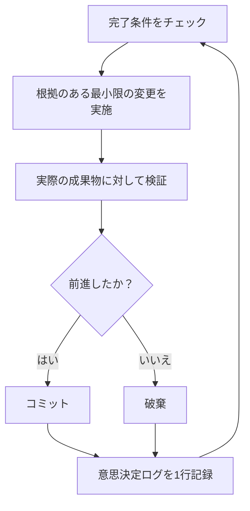

# 寝ている間に作業を進める

これこそが、これまでの準備すべてが報われる瞬間です。自分の作業を自ら検証できると信頼できるエージェントは、難しいタスクを単独で任せられるエージェントでもあります。それを安全に成立させているのは、単なる願望ではありません。機械的に判定できる完了条件、隔離された worktree またはクラウドエージェント、そして朝になってからあなたが監査できる意思決定ログがあるからです。


## ループを回す前に信頼を築く

信頼できないループを回しても、未確認の作業が高速に量産されるだけで、反復するたびに混乱が雪だるま式に膨れ上がります。エージェントを自律稼働させたまま席を離れる前に、その信頼に値するだけの条件が揃っているか確認してください：

- あなた自身がそのタスクを一度手作業で行ったことがあるか、エージェントが実行する様子を見守ったことがあり、「何が正しい状態か（what good looks like）」を把握している。
- あなた自身が使うのと同じツールやシグナル（検証スキル、プロファイラー、ログなど）をエージェントに与えている。
- すべてのステージで作業結果が証明され、基準に満たない場合はラインを停止できるようになっている。
- 過去のトランスクリプト（実行履歴）をいくつか読み、繰り返し発生する失敗パターンをツールやスキル、チェック機構へと落とし込んでいる。

これら4つがすべて揃ってから初めて、ループを自律化してください。それまでは、自分の目の届く範囲で実行しましょう。

## 夜間実行の取り決め（オーバーナイト契約）

優れた引き継ぎには、「ゴール」「完了条件」「許可事項」「緊急脱出口（エスケープハッチ）」の4つが含まれます。長々と書く必要はありません：

```text
/poteto-mode これから寝る。<base> から切った新しい worktree で、すべての呼び出し元を新しいパーサーに移行して。
古い呼び出し元がゼロになり、すべてのパーサーのテストデータ（フィクスチャ）がパスし、古い API が削除されたら完了とする。
意思決定ログを記録して。コミット前の確認は不要。
/loop 完了するまで繰り返して。数時間経っても本当に行き詰まっている場合は、停止して理由を書き出して。
```

各行がどのような役割を果たしているか見てみましょう：

- 「これから寝る（im going to bed）」はセッション全体の上書き指示として機能します。これにより、エージェントは途中で質問するのをやめ、作業を自律的に進め続けます。
- 「〜したら完了とする（done means...）」は、曖昧なゴールを毎回のイテレーションで実行・判定できる具体的なチェック基準へと変換します。
- 「`<base>` から切った新しい worktree」と指定することで、あなたが他に開いている作業ツリーと衝突するのを防ぎます。
- 「コミット前の確認は不要」と伝えることで、通常ならエージェントが確認待ちでブロックしてしまう許可事項に事前回答しておきます。
- `/loop` は pstack のスキルではなく、Cursor に組み込まれた定期起動（ウェイク）メカニズムです。[Autonomous run プレイブック](../../skills/poteto-mode/playbooks/autonomous-run.md) はこれを利用し、イベント発生時やハートビート間隔で完了条件を再チェックします。
- 緊急脱出口（行き詰まったら停止して理由を書き出す指示）を設けることで、本当に行き詰まった際に8時間かけてゴールを勝手に独自解釈し続けるような暴走を防ぎ、潔く停止して理由を報告させることができます。

席を外した後にあなたがレビューする前提の作業であるため、`/poteto-mode` はこれを [`/figure-it-out`](../../skills/figure-it-out/SKILL.md) にルーティングし、コードを1行も書く前に実行フェーズを設計して意思決定ログを組み込みます。

稼働中のループを意図的に止めたい場合は、エージェントに一時停止するよう伝えるか、これからオフラインになる・Cursor を再起動する旨を伝えてください。[Pause safely プレイブック](../../skills/poteto-mode/playbooks/pause-safely.md) が現在のステップを完了またはロールバックし、作業中（WIP）のチェックポイントをコミットしたうえで、再開用のメモを書き出します。新しいチャットを開けば、Session pickup プレイブックを通じてそのメモから作業を引き継ぐことができます。なお、「続けて（keep going）」と伝えただけでは一時停止がトリガーされることはありません。

## 一晩中ループが実行する処理



イテレーションごとに「1つの変更、1つのチェック、1行のログ記録」を繰り返します。改善につながらなかった変更は放置せず、その場で破棄されます。進捗が頭打ち（プラトー）になった場合は停止するのではなく別アプローチへ方向転換し、完了宣言を出すために完了条件をこっそり緩めるようなことは決してしません。

## 朝の監査（モーニングオーディット）

夜間の実行内容を後からレビュー可能にしているのが [`/show-me-your-work`](../../skills/show-me-your-work/SKILL.md) です。各行には時刻、フェーズ、意思決定内容、理由、証拠へのポインタ、および結果が `decisions.tsv`（複数の実行が同じディレクトリを共有する場合は `.audit/<task-slug>.tsv`）という TSV ファイルに記録されます。デフォルトではローカルに留まりますが、レビュアーが結果を信頼するために判断の軌跡を必要とするような大掛かりな作業の場合は、リポジトリにコミットしてください。

戻ってきたら、レビュー形式で実行結果を報告させてください：

```text
/show-me-your-work 昨晩やったことをレビューできる形でキャッチアップさせて
```

このスキルは要約を返す前に、別のモデルファミリーのレビュアーサブエージェントを起動して意思決定の軌跡とトランスクリプトを読み込ませます。そして返信の末尾に、あなたが精査すべき項目をまとめた「Attention（要注意事項）」セクションを出力します。まずはそのセクションを読み、次にそこが指し示しているログの行を確認してください。一晩分のログを最初から最後まで読み直す必要はなく、重要な意思決定だけを監査すればよいのです。

監査ではなく手短な状況把握だけをしたい場合は、作業を実行していたチャットで [`/ketchup`](../../skills/ketchup/SKILL.md) を実行してください。読み取り専用で動作し、あなたの最後のメッセージ以降に何が変化したかを、生成されたスクリーンショットや小さな図解とともに平易な言葉で教えてくれます。さらに、マージ、承認、選択肢の決定など、あなたの判断待ちとなっている項目をすべてリストアップし、それぞれの推奨案・根拠・リスクを添えて提示してくれるため、その返信を読むだけで意思決定を完結できます。

## 1つのタスクではなく、作業キューを一晩でさばく場合

先ほどの取り決めは、1つのタスクを1つの完了条件まで導くためのものです。しかし夜間の作業には、独立した複数の変更キューやプロジェクト全体の移行など、さらに規模の大きいものもあります。そうした場合は、2つのプレイブックと1つのスキルで同じ信頼性をスケールアップできます。

[Autopilot-full](../../skills/poteto-mode/playbooks/autopilot-full.md) は、独立した複数の PR のキューをマージ完了まで自動で進めます。各 PR には構築からマージまでを一貫して担当するオーナーエージェントが1体割り当てられますが、オーナー自身の判断だけでマージすることは禁止されています。オーナーが「コード準備完了」とした HEAD コミットに対して、新鮮な検証ワーカーのスウォーム（群れ）がチェックを行います。その後のリベースや軽微な修正には新しい検証ワーカーが1体割り当てられ、新しい挙動の追加や大きな差分が発生した場合にのみ、再度フルスウォームによる検証が行われます。マージ対象となるパッチに対してクリーンな合格判定（verdict）が出た場合にのみ、マージが許可されます：

```text
/poteto-mode このキューをフルオートパイロット（full autopilot）で進めて。各項目は独立しているから、朝までにすべてマージしておいてほしい。
```

[Autopilot-stack](../../skills/poteto-mode/playbooks/autopilot-stack.md) は、マージを行わない Autopilot-full です。朝起きると、それぞれ検証結果（verdict）が付いた検証済みの PR 群が出来上がっているので、あなた自身でレビューしてマージできます。ある PR の上に別の PR が積み上げられる（スタックされる）のは、前者の変更を前提として構築される場合のみです。何かがマージされる前に必ず自分の目で確認したい場合は、Autopilot-full ではなくこちらを選んでください：

```text
/poteto-mode これら5つの変更をオートパイロットで進めて。ただしマージはしないで。朝になってから自分でマージする。
```

多数のパッケージにまたがるマイグレーションなど、プログラム全体規模の作業には専用のプレイブックはありません。`/poteto-mode` は大規模または横断的な作業を [`/figure-it-out`](../../skills/figure-it-out/SKILL.md) にルーティングし、そのタスク専用の厳格な実行計画を設計します：

```text
/poteto-mode すべてのパッケージを新しいストアに移行して。各パッケージの変換とマージが完了するまで責任を持って進めて。1日に2回進捗を確認しに来る。
```

## 複数のプロジェクトを並列で走らせる

[Cursor Project](https://cursor.com/blog/projects) を使うと、1つのコーディネーターエージェントに永続的なスレッドを持たせることができます。コーディネーター自身はコードを書きません。サブエージェントに指示を出すことに専念し、サブエージェントはデフォルトでクラウド上で実行されるため、あなたがノート PC を閉じていても作業は進み続けます。コーディネーターへのプロンプトを `/poteto-mode` で始めれば、起動されるすべてのサブエージェントもプレイブックに従います。起動された各エージェントは最初に [`worker.md`](../../skills/poteto-mode/worker.md) を読み込むため、キックオフ時の高い基準を維持しつつ、後から覆せる（可逆な）判断はあなたに尋ねずに自分で決断し、レビュー準備が整った状態で PR を作成します。

運用をうまく回すコツをいくつか紹介します：

- 機能開発、マイグレーション、パフォーマンス改善、技術的負債の解消など、作業のまとまりごとに専用の Project を作成する。複数の Project を並行して走らせることができます。
- 関連するチャット（完了済みのものも含む）を Project にドラッグ＆ドロップして放り込む。それらが Project 内のすべてのエージェントにとっての共有コンテキストになります。
- マージ前の各 PR には検証スウォームを割り当て、キューの消化は Autopilot-stack または Autopilot-full に任せる。
- コーディネーターにはデータに裏付けられた計画を作成させ、未解決の疑問についてはあなたに質問する前にプロトタイプを作って答えを出させる。

調査から実行まで、1つのプロンプトで Project 全体を動かすことも可能です：

```text
/poteto-mode このリポジトリのアーキテクチャがよりエージェントフレンドリーになるようにリファクタリングして。過去のコミットやレビューコメントに対して /correct と /architect を使い、ここでエージェントが最もよく犯すミスを特定して。過去のチャットからのコンテキスト取得には /recall を使って。未解決の疑問は私に質問する代わりにプロトタイプを作って答えを出して。実際のデータに裏付けられた計画書を持って戻ってきて。私が承認したら autopilot-stack か autopilot-full で実行するから、どちらにするかそのとき尋ねて。
```

## ループ自体を自動起動させる

ここまでに紹介したループはすべて、あなたが手動でスタートさせる必要があります。スケジュール実行やイベント駆動のオートメーション（Automations）を使えば、その最初のひと手間さえ不要になります。ソフトウェアの保守作業は、まさにこの仕組みにぴったりなステージに分割できます（不具合報告のトリアージ → 再現 → 修正 → 修正の検証）。このライン全体の信頼性を保つためのルールは2つです：

- すべてのステージがラインを停止できること。トリアージ担当は「これは仕様通りの挙動だ」と判断でき、再現担当は「再現しない」と判定でき、修正担当は「この変更はリスクが高すぎる」と判断できます。これらの結果はいずれも非常に有益です。なぜなら、不適切な作業が次のステージへ流れ込み、後から取り消すコストが膨らむのを未然に防げるからです。
- すべてのステージが証拠を引き渡すこと。再現ステージでは不具合状態のスクリーンショットや動画を添付し、修正ステージでは修正前後の証明を添付します。これにより人間は、コードを1行読む前に「エージェントが本当に正しい対象を直したか」を一目で確認できます。

pstack には、Slack の不具合報告に対応するための休止状態の[オートメーションパック（automation pack）](https://github.com/cursor/plugins/blob/main/pstack/automations/benny/README.md)が同梱されています。一方のオートメーションが各報告をトリアージし、もう一方が確認されたバグを再現し、小さなドラフト修正を作成することもあります。セットアップするには、対象リポジトリを指定したうえでエージェントに [`FOR_AGENTS.md`](https://github.com/cursor/plugins/blob/main/pstack/automations/benny/FOR_AGENTS.md) を参照させてください。

**落とし穴（Pitfall）：** 「作業時間」は完了条件になりません。「4時間この作業をして」と指示しても、エージェントにはチェックすべき基準が何もなく、朝起きたときに残っているのは「成果」ではなく「4時間分の動き回った痕跡」だけになります。`/loop` には必ず、合格（pass）か不合格（fail）かを判定できる述語（条件式）を与えてください。

次へ：[原則の名前を指定して舵を取る](./08-principles.md)
